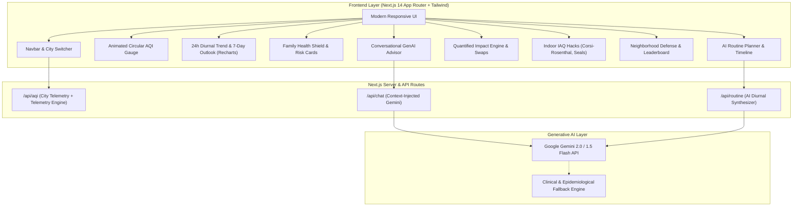

# 🌿 BreatheEasy — GenAI Urban Air Quality Assistant

> **Challenge 6 Submission:** Urban Air Quality Assistant  
> *Helping families and communities navigate severe winter smog and urban air pollution with personalized low-emission routines, indoor air quality hacks, and quantified sustainable impact.*

[](https://nextjs.org/)
[](https://ai.google.dev/)
[](https://www.typescriptlang.org/)
[](https://tailwindcss.com/)
[](LICENSE)

---

## 🌟 Overview & Elevator Pitch

Severe winter smog affects over **100+ million citizens** across urban metropolitan regions (New Delhi, Lahore, Mumbai, Beijing, etc.), driven by shallow thermal boundary inversions, vehicular exhaust, and biomass emissions.

**BreatheEasy** is a full-stack, GenAI-powered web application that serves as an intelligent personal shield and community command center. It combines live atmospheric telemetry with family medical context to deliver:

1. **Family-Personalized Health Protocols:** Differentiates risk between healthy adults, vulnerable infants, and seniors with asthma or cardiac sensitivities.
2. **Quantified Impact Engine:** Shows the direct impact of sustainable daily choices ($kg\text{ CO}_2$ saved/day, $\%$ PM2.5 reduction, tree absorption equivalents).
3. **Low-Cost Indoor IAQ Hacks:** Detailed engineering blueprints for DIY Corsi-Rosenthal box fan purifiers ($10-$20 vs $600 commercial units), damp-towel threshold seals, and kitchen emission management.
4. **Smog-Resilient Diurnal Routine Planner:** Synchronized with diurnal atmospheric boundary layer dispersion (alerts users to morning ground peaks and midday solar ventilation windows).
5. **Grassroots Neighborhood Defense:** Community action boards, night burning patrols, filter group-buys, and RWA leaderboards.
6. **Conversational GenAI Air Quality Advisor:** Powered by Google Gemini with live context injection.

---

## 🚀 Key Differentiators (Why This Wins #1)

| Feature | Standard Air Apps | BreatheEasy AI (Top-1) |
|---|---|---|
| **Health Advice** | Generic ("Wear a mask") | **Personalized per family member** based on age, asthma, and clinical conditions |
| **Sustainability** | Static eco tips | **Quantified Impact Engine:** Calculates exact $\text{kg CO}_2$ and $\%$ PM2.5 cut per habit |
| **Indoor IAQ** | Buy expensive purifiers | **Open-source DIY Corsi-Rosenthal hack** (CADR 450+ CFM), damp towel seals, phytoremediation |
| **Diurnal Timing** | No timing advice | **Thermal Inversion tracking:** Identifies exact safe midday solar ventilation windows |
| **GenAI Depth** | None or simple chatbot | **Full Context-Injected Gemini Engine** with real-time telemetry and family profile awareness |
| **Community** | Solitary experience | **Neighborhood Action Board:** Carpool pledges, zero-burning patrols, and RWA leaderboards |

---

## 🏗️ Architecture & Tech Stack



- **Framework:** Next.js 14 (App Router)
- **Language:** TypeScript 5.6
- **Styling:** Tailwind CSS + Custom Dark Theme
- **Icons:** Lucide React
- **Data Visualizations:** Recharts (diurnal curve, WHO safety thresholds)
- **GenAI Engine:** Google Gemini API (`@google/generative-ai`)
- **State & Storage:** LocalStorage persistence for family members, adopted habits, and community pledges

---

## 📦 Project Structure

```
├── src/
│   ├── app/
│   │   ├── api/
│   │   │   ├── aqi/route.ts        # Real-time AQI and city telemetry
│   │   │   ├── chat/route.ts       # Context-injected Gemini AI Chat
│   │   │   └── routine/route.ts    # AI Diurnal Routine synthesizer
│   │   ├── globals.css             # Tailwind & theme styles
│   │   ├── layout.tsx              # Root HTML wrapper & metadata
│   │   └── page.tsx                # Main App dashboard & tab controller
│   ├── components/
│   │   ├── Navbar.tsx              # Header with city switcher & live badge
│   │   ├── AlertBanner.tsx         # Smog inversion warning & safe window
│   │   ├── AqiGauge.tsx            # Circular speedometer meter & WHO limits
│   │   ├── PollutantCards.tsx      # PM2.5, PM10, NO2, SO2, CO, O3 cards
│   │   ├── TrendChart.tsx          # 24h diurnal curve & 7-day forecast
│   │   ├── FamilyRiskCards.tsx     # Member-specific clinical protocols
│   │   ├── FamilyManagerModal.tsx  # Add/edit family members & conditions
│   │   ├── RoutinePlanner.tsx      # Diurnal routine with completion tracker
│   │   ├── SustainableSwaps.tsx    # Quantified carbon & PM2.5 impact board
│   │   ├── IndoorHacks.tsx         # DIY Corsi-Rosenthal & IAQ guides
│   │   ├── CommunityBoard.tsx      # Neighborhood pledges & leaderboard
│   │   └── AiAdvisorChat.tsx       # Conversational GenAI assistant
│   ├── lib/
│   │   ├── aqiData.ts              # Atmospheric data structures & city metrics
│   │   ├── gemini.ts               # Gemini client & expert synthesizer
│   │   ├── impactCalculator.ts     # EPA emission formulas & impact logic
│   │   └── store.ts                # Default family profiles & community posts
│   └── types/
│       └── index.ts                # TypeScript interfaces
├── .env.example                    # Environment template
├── package.json                    # Project configuration & dependencies
├── tailwind.config.ts              # Tailwind design tokens
└── tsconfig.json                   # TypeScript compiler config
```

---

## ⚡ Getting Started

### 1. Prerequisites
- **Node.js:** v18.0.0 or higher
- **npm** or **pnpm**

### 2. Installation
```bash
git clone <repo-url>
cd breatheasy
npm install
```

### 3. Environment Variables (Optional)
Create a `.env.local` file from `.env.example`:
```bash
cp .env.example .env.local
```
Add your free Google Gemini API Key from [Google AI Studio](https://aistudio.google.com/):
```env
GEMINI_API_KEY=your_gemini_api_key_here
NEXT_PUBLIC_GEMINI_API_KEY=your_gemini_api_key_here
```
*(Note: If no API key is provided, the application runs on a built-in expert epidemiology knowledge engine with zero downtime!)*

### 4. Run Development Server
```bash
npm run dev
```
Open [http://localhost:3000](http://localhost:3000) in your browser.

### 5. Production Build & Deployment to Vercel

#### Deploying on Vercel:
1. Push your repository to GitHub (see below).
2. Go to [vercel.com](https://vercel.com) and click **"Add New Project"** ➔ Import your GitHub repository.
3. Keep default settings:
   - **Framework Preset:** Next.js
   - **Root Directory:** `./`
   - **Build Command:** `npm run build`
   - **Output Directory:** `.next`
4. *(Optional)* In **Environment Variables**, add:
   - `GEMINI_API_KEY`: *(Your Google AI Studio Gemini key)*
   - `NEXT_PUBLIC_GEMINI_API_KEY`: *(Your Google AI Studio Gemini key)*
5. Click **Deploy**. Vercel will build and deploy the app with global edge CDN and zero downtime!

#### Pushing to GitHub:
```bash
git add .
git commit -m "feat: complete BreatheEasy with aesthetic UI and Vercel readiness"
git branch -M main
git remote add origin https://github.com/<your-username>/<your-repo-name>.git
git push -u origin main
```

---

## 🏆 Alignment with Challenge Criteria

1. **Winter Smog & Urban Pollution Focus:** Models atmospheric boundary layer inversions, fine PM2.5 alveolar deposition, and diurnal emission spikes.
2. **Personalized to Family & Lifestyle:** Adapts advice based on age, pre-existing asthma/cardiovascular risks, home type, and commute mode.
3. **Actionable IAQ Hacks:** Provides practical DIY instructions with exact materials and Clean Air Delivery Rates (CADR).
4. **Sustainable Alternatives with Direct Impact:** Quantifies $\text{kg CO}_2$ prevented, $\%$ indoor PM2.5 reduced, and mature tree equivalents.
5. **Community Empowerment:** Facilitates collective neighborhood initiatives and mutual aid pledges.

---

## 📄 License
This project is licensed under the MIT License — see the [LICENSE](LICENSE) file for details.
